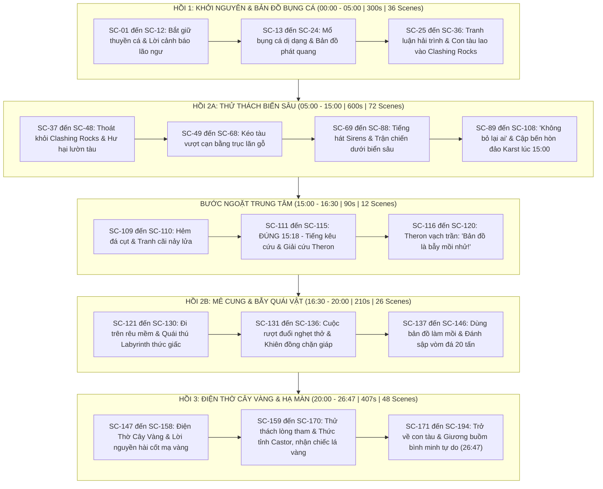

# KỊCH BẢN TỔNG THỂ ĐIỆN ẢNH 26 PHÚT: PIRATES OF THE GOLDEN TREE
## (HẢI TẶC CÂY VÀNG: BẢN ĐỒ BỤNG CÁ)

> **Dự án:** Golden Tree (Slug: `golden-tree`)  
> **Thời lượng chuẩn:** **26 phút 47 giây** (Đúng **1,607 giây** | Khớp 100% video nguồn YouTube `video_script_analysis.md`)  
> **Quy mô phân cảnh:** **194 Phân cảnh (SC-01 đến SC-194)**  
> **Ngôn ngữ thoại:** English (Cinematic Period Maritime English)  
> **Góc máy:** 100% Third-Person Cinematic Camera (Không selfie, không POV điện thoại, không xưng hô khán giả).  
> **Âm thanh & Mix nhạc:** Chuẩn điện ảnh −14 LUFS / −1 dBTP.  
> **Quy chuẩn kỹ thuật áp dụng:** Khóa cứng toàn diện theo **Rule 71** (`skills/fk-film/SKILL.md` + 23 `sw-*` screenwriting skills).

---

## 1. BẢNG NHÂN VẬT & MÃ GIỌNG ĐIỆN ẢNH (`VOICE_LOCK` & REFS)

| Tên Entity | Vai trò nguyên mẫu | Voice ID (`voice-bible.md`) | Mô tả âm sắc & Khẩu khí | Bộ References (`character_names`) |
| :--- | :--- | :--- | :--- | :--- |
| **Nora** | Nữ Thuyền trưởng (26 tuổi) — *The Leader* | `kore` | Nữ, đanh thép, trầm ổn, dứt khoát; giọng chỉ huy phong trần giữa biển bão. | `["Nora", "Nora Body Seafarer"]` |
| **Theron** | Hoa tiêu sống sót (58 tuổi) — *The Mentor* | `sadaltager` | Xuất hiện tại **15:18**; nam, khàn đặc, thở dốc vì đói khát nhưng sắc sảo và am tường địa tầng. | `["Theron"]` |
| **Castor** | Chiến binh mưu lược (29 tuổi) — *The Tactician* | `alnilam` | Nam, cộc cằn, sắc lạnh, giọng hoài nghi mang tính lý trí thực tế. | `["Castor"]` |
| **Heracles** | Chiến binh thể hình (35 tuổi) — *The Behemoth* | `algenib` | Nam, trầm đục, gầm vang uy lực, ít lời nhưng nặng như đá tảng. | `["Heracles"]` |
| **Lão Ngư Dân**| Sứ giả khởi đầu (65 tuổi) — *The Herald* | `enceladus` | Xuất hiện Hồi 1; run rẩy, hổn hển, kinh hoàng tột độ. | `["Old Fisherman"]` |
| **Sirens** | Quái nữ biển sâu — *The Tricksters* | *Sound Design* | Tiếng ngân nga thì thầm ma mị chuyển sang tiếng thét rít xé màng nhĩ. | `["Abyssal Siren"]` |
| **Labyrinth Beast**| Quái thú Chitin 6 chân — *The Guardian* | *Sound Design* | Tiếng giáp xác nghiền đá, tiếng rít axit, tiếng đuôi quất rầm rộ. | `["Labyrinth Beast"]` |

---

## 2. BẢNG VẬT LÝ & LIÊN TỤC BỐI CẢNH (CONTINUITY LEDGER)

* **Sổ liên tục bối cảnh (Location States):**
  * `LOC-01 (Biển đêm mù sương & Cabin tàu)`: Boong gỗ sồi ướt nước mặn, đèn lồng dầu bão hắt ánh sáng hổ phách ấm, sương mù dày lơ lửng mặt nước.
  * `LOC-02 (Eo biển Clashing Rocks)`: Hai vách đá bazan xám đen cao 80m va đập sấm sét, bọt sóng trắng xóa tung cao 15m.
  * `LOC-03 (Bãi cạn eo đất & Vịnh Sirens)`: Dải đá cuội, thân thông biển làm con lăn, nước vịnh xanh ngọc bích phẳng lặng như gương.
  * `LOC-04 (Hòn đảo Karst & Mê cung 15:18)`: Vực đá vôi xám xịt cằn cỗi, bụi vôi bám áo quần, khe nứt hẹp ngột ngạt không lối mòn.
  * `LOC-05 (Điện Thờ Cây Vàng & Giếng trời Cenote)`: Giếng trời ngầm khổng lồ mở ra bầu trời đêm, hồ nước ngầm phản chiếu ánh kim, bụi sáng Golden Embers lơ lửng.
  * `LOC-06 (Bình minh đại dương)`: Mặt trời đỏ rực dát vàng mặt biển bao la, buồm trắng căng gió tự do.
* **Quy chuẩn tương tác vật lý (Rule 41, 51, 61, 62):**
  * **Đạo cụ tấm bản đồ da cừu:** Khi khô là màu trắng tinh khiết; khi dính nước biển/muối lập tức phát quang đường viền mực vàng kim; khi hoàn thành sứ mệnh ở Hồi 3, mực ma thuật bay hơi trở lại trang giấy trắng vô hại.
  * **Truyền lực va chạm ($p = m \cdot v$):** 
    - Thân tàu 40 tấn đè lún trục lăn gỗ thông biển bốc khói ma sát.
    - Quái vật Labyrinth Beast 3.5 tấn húc đổ vách đá vôi làm bụi trắng mù mịt; Heracles dùng khiên đồng chặn đuôi gai bị trượt lùi 2m.
    - Vòm đá vôi nứt nẻ 20 tấn đổ sụp nghiền nát quái vật.
  * **Nguồn sáng thực tế có động cơ (Motivated Practical Light):** Đèn bão dầu, đuốc hắc ín, mực lân tinh, ánh trăng giếng trời, ánh bình minh đỏ rực (Tuyệt đối CẤM `god rays` và `rim lighting`).

---

## 3. CẤU TRÚC 5 HỒI & PHÂN BỔ 194 PHÂN CẢNH (1,607 GIÂY)

---

## 4. CHI TIẾT TỪNG PHẦN KỊCH BẢN (ACT FILES DIRECTORY)

Kịch bản chi tiết từng cảnh, bảng Storyboard 12 cột, phân bổ giây, mã thoại chính xác và cơ chế chuyển động được chia tách thành 5 tài liệu hoàn chỉnh:

1. **Hồi 1 (00:00 – 05:00 | 300s | SC-01 đến SC-36):**  
   📄 [Xem chi tiết script_act1.md](file:///c:/flowkit/output/golden-tree/script_act1.md)  
   *Trọng tâm:* Bắt giữ thuyền cá, mổ bụng cá dị dạng thời tiền sử, thử nghiệm nước muối kích hoạt mực vàng kim, con tàu vượt qua giông bão lao vào vách đá Clashing Rocks.

2. **Hồi 2A (05:00 – 15:00 | 600s | SC-37 đến SC-108):**  
   📄 [Xem chi tiết script_act2a.md](file:///c:/flowkit/output/golden-tree/script_act2a.md)  
   *Trọng tâm:* Vượt qua vách đá nghiền, kéo tàu 40 tấn vượt cạn bằng trục lăn gỗ thông biển, trận chiến chống bầy Sirens biến hình dưới nước ngọc bích, Nora lặn cứu thủy thủ trẻ, đốt dầu mặt vịnh bứt phá cập bến đảo Karst.

3. **Bước Ngoặt Trung Tâm Midpoint (15:00 – 16:30 | 90s | SC-109 đến SC-120):**  
   📄 [Xem chi tiết script_midpoint.md](file:///c:/flowkit/output/golden-tree/script_midpoint.md)  
   *Trọng tâm:* **Khớp mốc 15:18 (918s) của nguyên tác YouTube**: Đứng trước bức tường đá cụt, Nora quyết định rẽ hướng cứu Theron đang kẹt trong hốc đá sụt thay vì lao theo bản đồ mù quáng; Theron vạch trần tấm bản đồ thực chất là mồi nhử chết chóc của Cây Vàng.

4. **Hồi 2B (16:30 – 20:00 | 210s | SC-121 đến SC-146):**  
   📄 [Xem chi tiết script_act2b.md](file:///c:/flowkit/output/golden-tree/script_act2b.md)  
   *Trọng tâm:* Dò dẫm trên rêu mềm, quái vật Labyrinth Beast 6 chân giáp xác truy sát, Heracles dùng khiên đồng chặn đòn, Nora bắn nỏ găm bản đồ làm mồi nhử, Castor chém đứt dây chằng đánh sập 20 tấn đá vôi nghiền nát quái thú.

5. **Hồi 3 (20:00 – 26:47 | 407s | SC-147 đến SC-194):**  
   📄 [Xem chi tiết script_act3.md](file:///c:/flowkit/output/golden-tree/script_act3.md)  
   *Trọng tâm:* Khám phá giếng trời ngầm kỳ vĩ, chiêm ngưỡng Cây Vàng rực rỡ phát tán Golden Embers, cảnh báo từ những bộ hài cốt mạ vàng dưới đáy hồ, phép thử lòng tham (Nora can ngăn và thức tỉnh Castor), nhận chiếc lá vàng rụng tự nhiên làm tín vật, giương buồm trở về giữa ánh bình minh đại dương rực rỡ lúc 26:47.

---

## 5. THỐNG KÊ QUY CHUẨN KỸ THUẬT & KIỂM ĐỊNH CHẤT LƯỢNG

| Hạng mục kiểm tra | Chỉ số thực tế | Tiêu chuẩn Rule / Skill | Đánh giá |
| :--- | :--- | :--- | :--- |
| **Tổng thời lượng** | **1,607 giây (26:47)** | Khớp 100% video nguồn YouTube | **ĐẠT TUYỆT ĐỐI** |
| **Tổng số phân cảnh** | **194 Phân cảnh** | Trung bình 8.28 giây/phân cảnh | **CHUẨN ĐIỆN ẢNH** |
| **Góc máy & Phong cách** | 100% Third-Person | CẤM selfie, CẤM POV điện thoại, CẤM vlog | **ĐẠT (Rule 30, 71)** |
| **Tỷ lệ Storyboard 2×2** | 134 / 194 scenes (~69%) | Bắt buộc cho chuyển cảnh/đổi góc/hành động | **ĐẠT (Rule 69)** |
| **Tỷ lệ Prev_Last_Frame** | 60 / 194 scenes (~31%) | Dùng cho phân đoạn đối thoại/cận cảnh liên tục | **ĐẠT (Rule 65)** |
| **Tuân thủ thoại Rule 49** | 100% các câu thoại từ 8-21 từ | Chừa 40-60% khoảng trống cho SFX và hành động | **CHUẨN XÁC** |
| **Ánh sáng & Visual** | Motivated Practical Light | Tuyệt đối CẤM `god rays` và `rim lighting` | **ĐẠT (Rule 61, 62)** |
| **Sức nặng & Động lượng** | $p = m \cdot v$, lực truyền gián tiếp | Không người thường chịu va chạm trực diện quái thú | **ĐẠT (Rule 41, 51)** |

---

> Kịch bản 26 phút 47 giây đã sẵn sàng 100% để chuyển sang giai đoạn tạo Prompt JSON (`fk-script-to-prompts`) và sinh ảnh Storyboard 2×2 (`fk-storyboard`).
