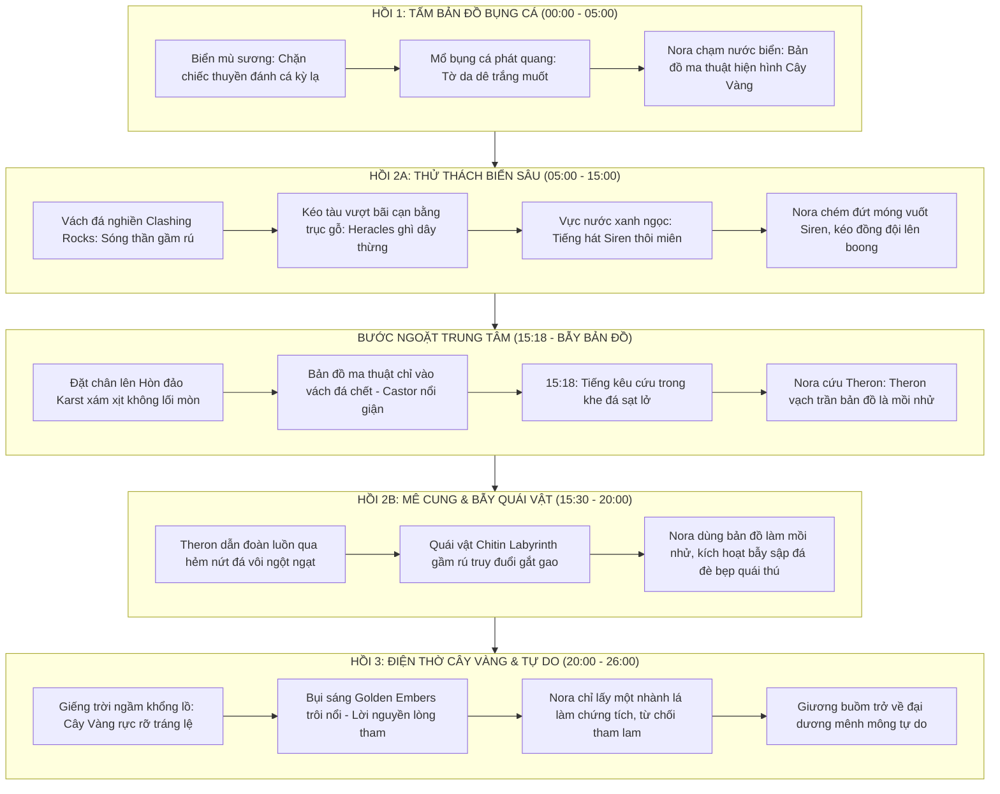

# Story Bible: Pirates of the Golden Tree (Hải Tặc Cây Vàng: Bản Đồ Bụng Cá)

> **Dự án:** Golden Tree (Slug: `golden-tree`)  
> **Định dạng:** Phim điện ảnh ngắn ngôi thứ ba (Third-person Cinematic Narrative Film)  
> **Phong cách:** Dark Fantasy / Mythological Adventure (Hy Lạp cổ kết hợp Hải tặc đại dương viễn chinh)  
> **Ngôn ngữ thoại:** English (Cinematic Period English)  
> **Tỉ lệ khung hình:** 16:9 HORIZONTAL  
> **Material:** `realistic`, `35mm film, cinematic documentary realism`, Panavision Anamorphic Lens, Cinematic Teal & Orange, Dark Chiaroscuro  

---

## 1. Premise & Theme (Tiền Đề & Chủ Đề Cốt Lõi — `/sw-premise-theme`)

### 1.1. Premise (Tiền đề kịch tính)
Khi tìm thấy một tấm bản đồ vô hình phát quang giấu trong bụng con cá dị dạng giữa đại dương mù sương, **Nữ Thuyền trưởng Nora** dẫn dắt thủy thủ đoàn dấn thân vào hành trình vượt qua eo biển vách đá nghiền và tiếng hát Sirens chết chóc để tìm kiếm Điện Thờ Cây Vàng huyền thoại. Nhưng khi đặt chân lên hòn đảo đá vôi mê cung, cô đối mặt với sự thật: tấm bản đồ ma thuật thực chất là chiếc bẫy dẫn tới cái chết nếu thiếu đi tri thức thực địa và sự đồng lòng của con người.

### 1.2. Controlling Idea (Ý niệm định hướng — Robert McKee)
* **Ý niệm tích cực:** Sự sống sót và vinh quang chân chính chỉ đạt được khi người thủ lĩnh đặt mạng sống đồng đội và tri thức thực tế lên trên lòng tham mù quáng trước ảo mộng kho báu ma thuật.
* **Ý niệm phản đề:** Lòng tham bảo vật ma thuật làm tha hóa lý trí, khiến con người mù quáng bước vào cạm bẫy diệt vong.

### 1.3. Dramatic Conflict (Xung đột kịch tính — Egri & Truby)
* **Xung đột nội tại (Inner Conflict):** Nora khao khát chứng minh quyền uy thủ lĩnh hải tặc và tìm ra vùng đất tự do cho đoàn thủy thủ, nhưng bị giằng xé giữa việc tin vào phép màu ma thuật hay dựa vào trực giác và tính mạng con người.
* **Xung đột giữa các cá nhân (Interpersonal Conflict):** Nora vs. Castor (sự hoài nghi lý tính, tranh cãi gay gắt về lộ trình) và Nora vs. Theron (sự cảnh giác ban đầu trước lời cảnh báo của kẻ sống sót hoang dại).
* **Xung đột ngoại cảnh (Extra-personal Conflict):** Thủy thủ đoàn vs. Sự tàn khốc của thiên nhiên (Vách đá nghiền Clashing Rocks), Ma thuật biển sâu (Sirens), và Quái vật Chitin Labyrinth trong mê cung đá ngầm.

---

## 2. Character Web & Casting (Mạng Lưới Nhân Vật — Bước 3)

| Nhân vật | Vai trò | Tuổi / Giới | Thiết kế Visual & Nhận diện | Voice ID (`voice-bible.md`) | Chức năng kịch tính |
| :--- | :--- | :--- | :--- | :--- | :--- |
| **Nora** | **Thuyền trưởng / Người hùng trung tâm (The Leader)** | 26 / Nữ | Nữ hải tặc da dẻ rám nắng, mặt trái tim, mắt xanh lục bảo (hazel-green), tàn nhang tự nhiên ngang sống mũi, tóc đỏ đồng (copper-red) tết lọn hải tặc phong trần. Áo tunic xanh thẫm, giáp ngực da thuộc nẹp đồng cổ, thắt lưng da dắt đoản kiếm Hy Lạp. | `kore` (Firm, confident, determined leader) | Ra quyết định sinh tử; giữ vững lời thề "Không bỏ lại ai". |
| **Theron** | **Người dẫn đường / Kẻ sống sót (The Stranded Guide)** | 58 / Nam | Lão hoa tiêu mắc kẹt tại hẻm đá ở mốc 15:18. Râu tóc bạc phơ xơ xác, áo choàng vải thô rách tơi tả dính bụi đá vôi xám, mắt thâm quầng đói khát nhưng sắc sảo. Cầm mảnh đá khắc cổ tự. | `sadaltager` (Knowledgeable, weathered elder) | Giải mã cơ chế bẫy của bản đồ ma thuật; dẫn đường qua mê cung ngầm. |
| **Heracles** | **Chiến binh khổng lồ (The Behemoth)** | 35 / Nam | Cơ bắp cuồn cuộn như đá tảng, râu quai nón dày rậm, giáp vai da sư tử biển, mang thắt lưng sắt to bản. Vết sẹo dài dọc cánh tay gân guốc. | `algenib` (Gravelly, deep, resonant) | Giải quyết chướng ngại vật lý quy mô lớn (vần tảng đá, kéo tàu vượt cạn). |
| **Castor** | **Chiến binh mưu lược (The Tactician)** | 29 / Nam | Gương mặt góc cạnh sắc lạnh, tóc đen cắt ngắn, trang phục giáp da nhẹ gọn ghẽ, đeo bao cung tên và thắt lưng nhiều dao găm. | `alnilam` (Firm, skeptical, sharp) | Phản biện chiến thuật, chất vấn tính xác thực của bản đồ ma thuật. |
| **Lão Ngư Dân** | **Sứ giả khởi đầu (The Herald)** | 65 / Nam | Thuyền đánh cá nhỏ trong sương. Da dẻ nhăn nheo cháy nắng, ôm bọc cá phát quang trong nỗi kinh hoàng tột độ. | `enceladus` (Breathy, trembling, lower) | Khởi phát biến cố (Inciting Incident), hé lộ bí mật về bụng con cá dị dạng. |
| **Quái vật Labyrinth** | **Sinh vật săn mồi / Kẻ gác đền (Antagonist Beast)** | Sinh vật | Quái thú lai giữa bọ cạp khổng lồ và bò sát tiền sử, lớp vỏ chitin màu than đen gồ ghề gai nhọn, mắt phát quang vàng đục, đuôi gai quét nát đá vôi. | *Không voice — Sound Design SFX gầm rít chấn động* | Mối đe dọa sinh tử truy sát trong hẻm hẹp; thử thách lòng dũng cảm. |

---

## 3. Cấu Trúc 5 Hồi Điện Ảnh (Story Structure — 5 Acts)

---

## 4. Visual Language & Cinematography (Mỹ Thuật Điện Ảnh — Rule 42, 57, 61)

1. **Third-Person Cinematic Camera:**
   * Góc máy người quan sát vô hình (Objective 3rd-person observer). Tuyệt đối không có góc nhìn selfie, không cầm máy, không phá vỡ bức tường thứ 4.
   * Cỡ cảnh biến hóa theo kịch tính: Wide Establishing Shot mở đầu hòn đảo -> Low-angle Hero Shot tôn vinh khí chất thuyền trưởng của Nora -> Shaky Handheld bám sát bước chân chạy trốn quái thú -> Slow Push-in lộng lẫy trước Điện Thờ Cây Vàng.

2. **Bảng màu & Xử lý Ánh Sáng (Teal & Orange + Dark Chiaroscuro):**
   * *Ngoại cảnh biển đêm & hẻm đá Karst:* Xanh biển thẫm (Deep Navy), Xám đá ướt (Charcoal Slate), Xanh mòng két (Teal) lạnh lẽo u uất.
   * *Điểm nhấn ma thuật & Cây Vàng:* Ánh sáng hổ phách (Warm Amber), Vàng kim rực rỡ (Molten Gold), Hạt bụi sáng trôi nổi (Golden Embers), Phát quang sinh học (Bioluminescent Cyan).
   * *Kỹ thuật chiếu sáng:* Rim lighting tách khối nhân vật khỏi phông nền tăm tối; Volumetric god rays chiếu từ giếng trời tự nhiên xuyên qua làn sương mù.

3. **Chống CGI & Tính Thực Tế Vật Lý (Rule 57, 59):**
   * Kết cấu vật liệu thô ráp, chân thực: da thú mòn xước, sớ gỗ sồi ẩm mục của thân tàu, vảy cá ướt nhớt lấp lánh phản chiếu ngọn đèn dầu, bụi đá vôi tung bay khi quái thú va chạm vách núi.
