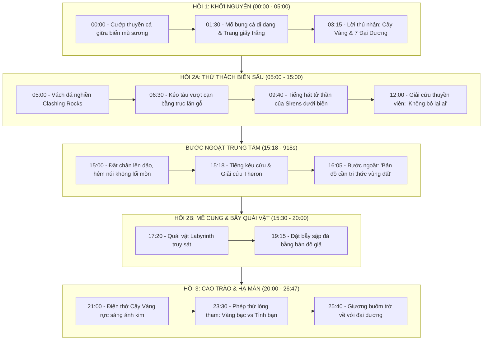

# Phân Tích Kịch Bản & Nghệ Thuật Thị Giác (Cinematography): "Pirates of the Golden Tree"

> **Dữ liệu nguồn:**
> * **Tác phẩm:** *They Found a Hidden Map Inside a Fish | Pirates of the Golden Tree | Full Fantasy Movie 4K*
> * **URL gốc:** [YouTube Link (mốc 15:18)](https://www.youtube.com/watch?v=kRtS9Kpt5BI&t=918s)
> * **Thời lượng:** 26 phút 47 giây | Độ phân giải gốc: 4K UHD
> * **Thể loại:** Dark Fantasy / Mythological Adventure (Hy Lạp cổ kết hợp Hải tặc đại dương)
> * **Công nghệ thực hiện:** AI-Generated Imagery & Motion (Midjourney v6 / Flux + Runway Gen-3 / Kling / Veo 3) + Synthetic Voices.

---

## MỤC LỤC
1. [Hồ Sơ Nhân Vật & Tuyến Vai (Character Bible)](#1-hồ-sơ-nhân-vật--tuyến-vai-character-bible)
2. [Cấu Trúc Kịch Bản 3 Hồi & Dòng Thời Gian Chi Tiết](#2-cấu-trúc-kịch-bản-3-hồi--dòng-thời-gian-chi-tiết)
3. [Phân Tích Bước Ngoặt Cốt Truyện Tại 15:18 (918s)](#3-phân-tích-bước-ngoặt-cốt-truyện-tại-1518-918s)
4. [Phân Tích Thị Giác, Góc Máy & Mỹ Thuật Điện Ảnh (Visual & Cinematography)](#4-phân-tích-thị-giác-góc-máy--mỹ-thuật-điện-ảnh-visual--cinematography)
5. [Giải Mã Thị Giác Từng Đại Cảnh (Scene-by-Scene Visual Breakdown)](#5-giải-mã-thị-giác-từng-đại-cảnh-scene-by-scene-visual-breakdown)
6. [Kỹ Thuật Giữ Tính Nhất Quán Nhân Vật AI Suốt 26 Phút](#6-kỹ-thuật-giữ-tính-nhất-quán-nhân-vật-ai-suốt-26-phút)
7. [Công Thức Visual Prompt Kỹ Thuật (Prompt Engineering Guide)](#7-công-thức-visual-prompt-kỹ-thuật-prompt-engineering-guide)

---

## 1. Hồ Sơ Nhân Vật & Tuyến Vai (Character Bible)

| Nhân vật | Vai trò nguyên mẫu | Thiết kế Visual & Trang phục | Chức năng kịch bản |
| :--- | :--- | :--- | :--- |
| **Jason** | **Thuyền trưởng / Người hùng (The Leader)** | Tóc nâu sẫm, áo giáp da hải tặc phong trần kết hợp áo choàng xanh biển thẫm, thanh kiếm chạm khắc biểu tượng Hy Lạp. Ánh mắt kiên nghị. | Đưa ra các quyết định sinh tử; là biểu tượng của tinh thần nghĩa khí và lòng trung thành. |
| **Heracles** | **Sức mạnh vô song (The Behemoth)** | Thể hình khổng lồ, râu quai nón dày rậm, giáp vai bằng da thú và thắt lưng sắt to bản. Vết sẹo dài trên cánh tay. | Giải quyết các chướng ngại vật lý quy mô lớn (vần đá, kéo tàu vượt cạn, đẩy lùi quái thú). |
| **Castor** | **Chiến binh mưu lược (The Tactician)** | Gương mặt góc cạnh, mắt sắc lạnh, trang phục gọn ghẽ với thắt lưng nhiều dao găm và cung tên. | Phân tích địa hình, cảnh báo cạm bẫy, luôn đặt dấu hỏi hoài nghi mang tính lý trí. |
| **Pollux** | **Tay thiện chiến dũng mãnh (The Enforcer)** | Phong trần, mang giáp ngực bằng đồng oxy hóa màu xanh gỉ sét, sử dụng rìu chiến lớn hoặc trường đao. | Tiên phong mở đường trong mọi cuộc giao tranh đẫm máu. |
| **Theron** | **Người dẫn đường (The Mentor/Guide)** | Xuất hiện tại **15:18**; râu tóc bạc phơ xơ xác, quần áo rách rưới bám đầy bụi đá vôi, đôi mắt mệt mỏi nhưng sắc sảo. | Cung cấp tri thức địa hình độc quyền, giải mã cơ chế vận hành của bản đồ vô hình. |
| **Lão ngư dân** | **Sứ giả khởi đầu (The Herald)** | Da dẻ nhăn nheo cháy nắng, ngón tay run rẩy ôm bọc cá, ánh mắt sợ hãi đến tột cùng. | Kích hoạt hành trình (Inciting Incident), cảnh báo về cái giá đắt của điều ước. |

---

## 2. Cấu Trúc Kịch Bản 3 Hồi & Dòng Thời Gian Chi Tiết



---

## 3. Phân Tích Bước Ngoặt Cốt Truyện Tại 15:18 (918s)

* **Hoàn cảnh kịch tính:** Đoàn thuyền viên đã vượt qua hiểm họa trên biển, đặt chân lên hòn đảo đá vôi khổng lồ bị lãng quên. Tại đây, ranh giới giữa niềm tin vào bảo vật ma thuật và thực tế tàn khốc bắt đầu va chạm.
* **Xung đột đối thoại tại 15:00 – 15:15:**
  * Castor hoài nghi: *"Đằng kia trông chẳng giống một con đường gì cả!"*
  * Jason bảo thủ dựa vào bản đồ: *"Không cần phải giống đường. Tấm bản đồ đã bảo đây là lối đi."*
* **Bước ngoặt đúng 15:18:** Tiếng kêu cứu nghẹn ngào từ hốc đá làm gián đoạn cuộc tranh luận. Quyết định của Jason: **rẽ hướng để cứu người sống sót thay vì lao thẳng theo bản đồ**.
* **Ý nghĩa cốt lõi:**
  1. **Giải ảo công cụ ma thuật:** Theron nói thẳng rằng bản đồ vô hình chỉ là tấm chỉ hướng mù quáng; nếu không am tường địa hình và các cạm bẫy của quái thú canh giữ, bản đồ chính là chiếc bẫy đưa người tìm đến cái chết.
  2. **Chuyển giao vai trò Người dẫn đường:** Theron từ kẻ yếu thế bị kẹt trở thành "Bộ não chiến thuật" dẫn đường cho cả nhóm qua mê cung hẹp.

---

## 4. Phân Tích Thị Giác, Góc Máy & Mỹ Thuật Điện Ảnh (Visual & Cinematography)

### 4.1. Bảng màu & Xử lý Ánh sáng (Color Palette & Lighting)
Toàn bộ 26 phút phim áp dụng phong cách phân màu điện ảnh chuẩn Hollywood (**Cinematic Teal & Orange** kết hợp **Dark Chiaroscuro**):

* **Tone màu chủ đạo biển cả & đêm tối:** Xanh biển sâu (Deep Navy), Xanh mòng két (Teal), Xám đá vôi ướt át (Charcoal Slate). Tạo cảm giác cô lập, hiểm trở và lạnh lẽo.
* **Tone màu ma thuật & kho báu:** Vàng kim rực rỡ (Luminous Gold), Hổ phách (Amber), Xanh ngọc bích phát quang (Bioluminescent Cyan). Tạo điểm nhấn thị giác (Focal Point) tương phản cực mạnh với bóng tối xung quanh.
* **Xử lý ánh sáng (Lighting Key):**
  * Sử dụng kỹ thuật **Volumetric God Rays** (tia sáng xuyên qua khe đá, xuyên qua làn sương mù biển).
  * **Rim Lighting (Ánh sáng viền):** Viền sáng sắc nét bao quanh bờ vai, tóc và giáp của nhân vật, giúp tách bạch rõ chủ thể khỏi hậu cảnh tối mù sương của hang đá.

### 4.2. Ngôn ngữ Góc Máy & Chuyển Động (Cinematography & Camera Motion)
Phim khai thác tối đa sức mạnh mô phỏng camera 3D của các mô hình video AI hiện đại:

1. **Extreme Wide Shot (Toàn cảnh cực rộng):** Dùng để thiết lập thế giới (World-building) — con tàu hải tặc đơn độc nhỏ bé giữa hai vách núi đá khổng lồ dựng đứng cao hàng trăm mét, hoặc giữa đại dương mịt mù bão giông.
2. **Low-Angle Hero Shot (Góc máy thấp tôn vinh nhân vật):** Đặt camera từ dưới hất lên khi Jason, Heracles đứng ở mũi tàu hoặc trước hang động. Góc máy này tạo cảm giác kiên định, phi phàm và uy quyền của những chiến binh thần thoại.
3. **Slow Forward Dolly / Push-in (Đẩy máy chậm vào cận cảnh):** Áp dụng trong các phân đoạn đối thoại nội tâm hoặc phát hiện manh mối (ví dụ lúc mổ bụng cá thấy trang giấy trắng, hoặc lúc bước vào điện thờ Cây Vàng). Kỹ thuật này kéo cảm xúc người xem vào sâu tâm trạng nhân vật.
4. **Shaky Handheld / Dynamic Tracking Shot (Máy quay rung lắc bám theo hành động):** Sử dụng triệt để trong cảnh quái vật truy đuổi trong mê cung đá ở Hồi 2B và lúc Sirens kéo thủy thủ xuống nước, tạo cảm giác hỗn loạn và nghẹt thở chân thực.

---

## 5. Giải Mã Thị Giác Từng Đại Cảnh (Scene-by-Scene Visual Breakdown)

### Đại Cảnh 1: Con Cá Dị Dạng & Bản Đồ Vô Hình (00:00 – 04:00)
* **Visual Key:** Một con cá cổ đại mang lớp vảy gồ ghề ánh xà cừ đen, bụng phát ra ánh sáng vàng lục mờ ảo bí hiểm.
* **Chi tiết cận cảnh (Macro Detail):** Khi lưỡi dao rạch lớp bụng cá, chất nhờn lấp lánh phản chiếu ánh đèn lồng tàu đêm. Tấm giấy trắng tinh khiết không tì vết nổi bật trên bàn gỗ mục ẩm ướt của cabin tàu hải tặc.

### Đại Cảnh 2: Vách Đá Nghiền & Kéo Tàu Vượt Núi (05:00 – 08:30)
* **Visual Key:** Sự hùng vĩ tột bậc của thiên nhiên. Hai mỏm núi đá đen xám lởm chởm va đập nhau tạo bọt sóng trắng xóa tung cao hàng chục mét.
* **Composition:** Đường dẫn thị giác chéo (Diagonal Leading Lines) tạo bởi độ nghiêng của vách đá. Các thân cây gỗ tròn được đặt làm con lăn dưới lườn tàu, bụi cát và đá dăm văng tung tóe khi cơ bắp của Heracles và thủy thủ căng cứng kéo dây thừng.

### Đại Cảnh 3: Tiếng Hát Sirens Dưới Biển Sâu (09:00 – 13:00)
* **Visual Key:** Phong cách kỳ ảo ma mị (Ethereal Underwater Fantasy). Ánh sáng mặt trời xuyên qua mặt nước màu xanh lục bảo (Emerald Green) tạo thành các cột sáng lung linh.
* **Chuyển đổi hình tượng (Visual Transformation):** Sirens ban đầu hiện lên với làn da trắng sứ, tóc bồng bềnh như lụa phát sáng; nhưng khi ra đòn, màng mắt chuyển đen hoàn toàn, khóe miệng rách toác để lộ nhiều hàng răng sắc nhọn như cá mập biển sâu.

### Đại Cảnh 4: Hẻm Núi Đá & Mê Cung Labyrinth tại 15:18 (15:00 – 19:30)
* **Visual Key:** Địa hình Karst đá vôi xám xịt, khô cằn và ngột ngạt. Bầu không khí bao phủ bởi lớp sương mù xám trắng lơ lửng ngang tầm mắt.
* **Chi tiết tại 15:18:** Góc máy nghiêng (Dutch Angle) nhẹ tạo cảm giác bất an. Khung hình đặc tả khuôn mặt Theron ló ra từ khe nứt hẹp giữa hai tảng đá sụt: râu ria bạc bù xù, mắt thâm quầng vì đói khát, nhưng đôi bàn tay vẫn siết chặt một mảnh đá khắc ký tự cổ.
* **Quái vật Labyrinth:** Tạo hình lai giữa bọ cạp khổng lồ và bò sát tiền sử, lớp vỏ chitin màu đen mun gồ ghề như đá núi, đuôi có gai nhọn quét qua làm sạt lở các gờ đá tạo hiệu ứng khói bụi mù mịt.

### Đại Cảnh 5: Điện Thờ Cây Vàng (20:00 – 26:00)
* **Visual Key:** Trực quan mãn nhãn nhất toàn bộ phim. Một hang vòm đá tự nhiên khổng lồ (Grotto) với giếng trời mở ra bầu trời đêm đầy sao.
* **Ánh sáng Cây Vàng:** Toàn bộ thân cây như được đúc từ vàng nguyên khối chảy, rễ cây ăn sâu vào khe đá phát quang mạch nước vàng óng. Tán lá là hàng vạn chiếc lá vàng mỏng manh rung rinh trong gió, phát tán ra không gian những hạt bụi sáng lấp lánh (Golden Embers/Sparks) trôi bồng bềnh như đom đóm.

---

## 6. Kỹ Thuật Giữ Tính Nhất Quán Nhân Vật AI Suốt 26 Phút

Một trong những thách thức lớn nhất của phim AI dài tập là tình trạng "nhảy mặt" (face drifting) hoặc đổi trang phục giữa các shot quay. Tác phẩm này đã áp dụng các giải pháp kỹ thuật sau:

1. **Character Anchor Sheet (Bảng neo chân dung):** Khởi tạo bộ ảnh xoay 360 độ của Jason, Heracles, Castor, Pollux với biểu cảm cố định từ giai đoạn concept art.
2. **Seed & Prompt Structuring cố định:**
   * Luôn khóa bộ từ khóa nhận diện: `Jason: 30yo Greek pirate captain, short trimmed dark brown hair, intense hazel eyes, weathered leather vest over deep navy tunic, brass shoulder buckle`.
3. **Quy trình Image-to-Video (I2V):**
   * Không sinh video trực tiếp từ Text (T2V) mà tạo Keyframe chuẩn chỉnh 100% bằng Midjourney/Flux trước, sau đó dùng chế độ **Image-to-Video** của Runway Gen-3 hoặc Kling AI để kiểm soát chuyển động máy quay và hành động mà không làm biến dạng khuôn mặt.
4. **Post-production Face Enhancement:** Chạy qua các công cụ phục hồi khuôn mặt (như CodeFormer hoặc ReActor) trong quá trình hậu kỳ để đảm bảo độ sắc nét 4K của biểu cảm mắt và miệng.

---

## 7. Công Thức Visual Prompt Kỹ Thuật (Prompt Engineering Guide)

Nếu bạn muốn tái tạo phong cách thị giác của bộ phim này trên các công cụ sinh hình ảnh/video AI, hãy áp dụng các công thức sau:

### Prompt 1: Cảnh Phát Hiện Tấm Bản Đồ Trong Bụng Cá (Scene 1)
```text
Cinematic 4K shot, interior of a dark wooden pirate ship cabin, dramatic chiaroscuro lighting. A mystical grotesque deep-sea fish cut open on an aged oak table, emitting a faint ethereal bioluminescent amber glow from inside its belly. Four weathered pirate men, Jason the handsome captain and Heracles the muscular giant, staring down in disbelief at a pristine blank white parchment glowing subtly. Lantern smoke floating in volumetric god rays, hyper-realistic textures of wet fish scales, leather, and rough wood. Shot on 35mm anamorphic lens, Panavision, cinematic color grading, photorealistic, 8k --ar 16:9 --style raw --v 6.1
```

### Prompt 2: Hẻm Núi Đá & Người Dẫn Đường Theron Tại 15:18 (Scene 4)
```text
Cinematic wide low-angle shot, a claustrophobic towering limestone canyon shrouded in eerie gray mist. An old weathered bearded hermit trapped inside a deep rocky crevice, reaching out for help, dirt and stone dust on his face, ragged clothes. A heroic pirate captain reaching his hand down to rescue him. High contrast dramatic shadows, harsh natural daylight filtering through the narrow ravine above, sharp stone textures, atmospheric dust particles floating, gritty dark fantasy aesthetic, IMAX cinematography, 4K resolution --ar 16:9 --v 6.1
```

### Prompt 3: Điện Thờ Cây Vàng (Scene 5 - Climax)
```text
Breathtaking wide establishing shot of an ancient subterranean grotto sanctuary. In the center stands a colossal mythical Golden Tree, its trunk made of glowing molten gold, roots spreading across crystal-clear water reflecting the light. Thousands of delicate shimmering gold leaves emitting radiant amber luminescence and floating golden embers into the air. A small group of pirates standing in awe on the stone shore, silhouettes backlit by divine golden light, magnificent god rays streaming from a natural cavern skylight above. Epic fantasy masterwork, Unreal Engine 5 render style meets Roger Deakins cinematography, hyper-detailed, 8k --ar 16:9 --v 6.1
```

---

## 8. Ứng Dụng Thực Tiễn Cho Dựng Phim CapCut (CapCut MCP Integration)

Khi đưa các video tạo từ AI vào CapCut biên tập, hãy tận dụng các công cụ vừa được tích hợp trong Antigravity:
* **`set_clip_blend_mode` (Hòa trộn Screen / Overlay):** Áp dụng lên các lớp phủ hiệu ứng bụi sáng vàng (*Golden Embers*), khói sương (*Fog overlay*) hoặc tia sáng mặt trời (*Light Leaks*) để tăng thêm 100% độ điện ảnh.
* **`set_clip_transform` (Keyframe Scale & Position):** Tạo chuyển động đẩy máy giả lập (Ken Burns effect) từ 1.0 lên 1.08 đối với các cảnh tĩnh để video AI luôn có cảm giác chuyển động mượt mà.
* **`set_clip_volume`:** Tăng giảm âm lượng linh hoạt giữa tiếng sóng biển gầm rú, tiếng quái vật và tiếng nhạc giao hưởng hào hùng.
