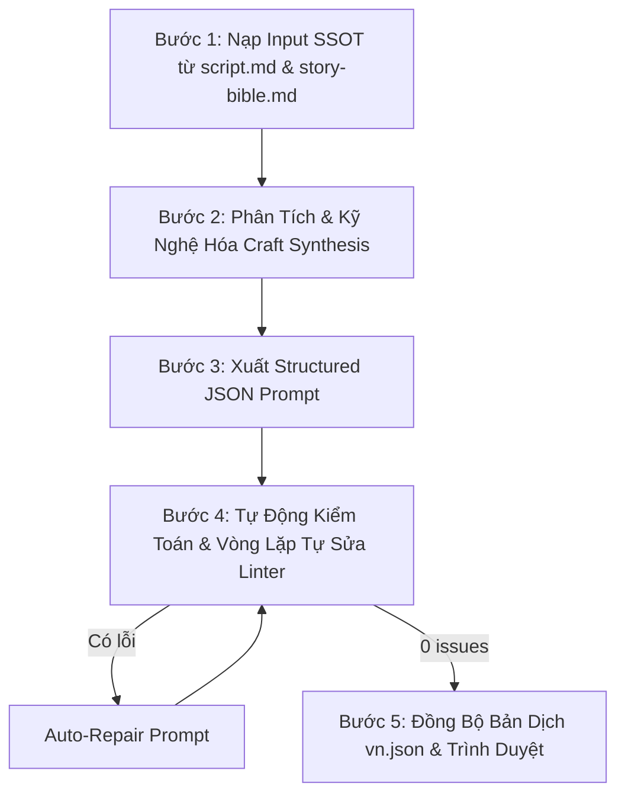

# 🎬 fk-script-to-prompts — Script-to-Prompt Converter & Validator

> **BẮT BUỘC CHO MỌI AGENT (Antigravity `agy` & Claude `claude`):**  
> Khi chuyển thể từ kịch bản phân cảnh (`script.md`) sang file Video Prompt JSON (`prompts_actX.json` / `prompts.json`), **TUYỆT ĐỐI CẤM VIẾT PROMPT AD-HOC TỰ DO LỘN XỘN HOẶC TỰ Ý CHẾ THOẠI**.  
> Agent **BẮT BUỘC** phải vận hành skill này để tích hợp toàn bộ **bộ Screenwriting Skills (`sw-*`)**, **bộ 7 Cinematic Subagents (`fk-*`)**, chạy quy trình **Self-Review & Linter Auto-Repair (`tools/lint_prompt.py`)**, và chỉ xuất file cuối cùng sạch 100% lỗi cho người dùng duyệt.

---

## 1. Danh Mục Các Skill Bắt Buộc Tích Hợp (Skill Registry)

Skill này là điểm hội tụ (Convergence Node) của 3 hệ thống kỹ nghệ:

### A. Hệ Thống Screenwriting Skills (`sw-*`)
1. **`sw-workflow` (Điều phối kịch bản & SSOT)**: Lấy `script.md` và `story-bible.md` làm chân lý tối thượng (Single Source of Truth), đảm bảo tính liên tục của nhịp điệu phân cảnh.
2. **`sw-scene-craft` (Kỹ nghệ phân cảnh - Robert McKee & Lục Quân)**:
   - **5 bước thiết kế cảnh**: Xác định xung đột $\to$ Ghi nhận giá trị mở đầu (+/-) $\to$ Phân rã nhịp (Beats: Hành động/Phản ứng) $\to$ Giá trị kết thúc (+/-) $\to$ Điểm đảo nghịch (Turning Point).
   - **"Chi tiết phải diệu" (细节要妙)**: Chi tiết cụ thể, xúc giác thực tế, loại bỏ hoàn toàn các khái niệm trừu tượng.
   - **"Đạo cụ phải tinh" (道具要精)**: Chuỗi đạo cụ xuyên suốt (mai rùa rỗng gieo nút đứt $\to$ vỡ ở hố nước; rãnh răng T. rex so với bàn tay gieo mầm mà không gọi tên dã thú).
   - **"Ý thú phải đủ" (意趣要足)**: Cài cắm huyền niệm và thủ pháp hoãn binh (Suspense & Delay), nín thở trước hiểm nguy.
3. **`sw-dialogue` (Kỹ nghệ đối thoại - Robert McKee & Lục Quân)**:
   - **Thoại là hành động (Dialogue as action)**: Mỗi câu thoại là một đòn tâm lý / chiến thuật thực hiện mục tiêu.
   - **3 tầng nội dung**: Nói ra (Said), Chưa nói (Unsaid / Subtext), Không thể nói (Unsayable / Sốc sinh tồn).
   - **CẤM TRIỆT ĐỂ On-The-Nose Exposition**: Tuyệt đối không để nhân vật tự giải thích thời gian, địa điểm, bối cảnh như hướng dẫn viên bảo tàng (*"Tôi vừa đến Hell Creek 66 triệu năm TCN..."* $\to$ **CẤM**).
   - **Khóa 100% thoại gốc từ `script.md` §9**: Chuẩn từng từ theo **Rule 49 bảng (0)**, khớp ngắt nhịp `/` theo mốc thời gian (`0-3s / 3-6s / 6-8s` hoặc `0-3s / 3-7s / 7-10s`).
   - **Giọng Laomedeia**: Upbeat, conversational, dry humor, tự giễu dưới áp lực, thét vỡ giọng khi nguy cấp.
4. **`sw-character-conflict` (Xung đột nhân vật & Tâm lý)**:
   - **Khát vọng (Want) vs Nhu cầu (Need)**: Khát vọng ngạo mạn muốn đứng ngoài quan sát vs Nhận thức thực tế mình là một con mồi trong chuỗi thức ăn.
   - **Niềm tin sai lầm (Misbelief)**: Thể hiện rõ niềm tin sai ở Act 1 để chuẩn bị bẻ gãy ở Act 4.
   - **Triệu chứng cơ thể sinh tồn (Body symptoms)**: Tim đập thình thịch, thở dốc qua mũi, run rẩy adrenaline, tay siết chặt.
5. **`sw-story-structure`**: Khung nhịp điệu 起承转合 (Khởi-Thừa-Chuyển-Hợp), Plot Point, Midpoint đảo nghịch.
6. **`sw-format-adaptation`**: Chuẩn hóa chuyển thể nghe-nhìn từ chữ viết sang hình ảnh và âm thanh.
7. **`sw-genre-anatomy`**: Khóa quy chuẩn thể loại Sinh tồn Kỷ Phấn Trắng / POV Vlog Lịch sử.

### B. Hệ Thống 7 Cinematic Subagents FlowKit (`fk-*`)
8. **`fk-camera-guide` (Đạo diễn hình ảnh & Quang học smartphone)**:
   - **Chu kỳ góc máy (§7)**: POV (EWS/WS) $\to$ Macro (ECU) $\to$ Hiding/OTS $\to$ Selfie (MCU) $\to$ Fixed (MS).
   - **Ràng buộc cứng**: Cấm 100% selfie, cấm 3 selfie liên tiếp, cấm 2 clip liền nhau cùng góc máy & cỡ cảnh.
   - **Quang học tự nhiên**: 0.5x ultra-wide, vertical footstep bounce, rotational lag, cấm góc nhìn gimbal bay lơ lửng.
   - **Khóa điểm mù quang học (Rule 52)**: Thấu kính máy quay và tay cầm máy luôn nằm ngoài khung hình (`completely outside the visible frame and never seen`). Bàn tay tự do luôn trống (`empty hand`).
   - **CẤM TỪ CẤM (Rule 52)**: Tuyệt đối không chứa `phone`, `smartphone`, `screen`, `device`, `selfie stick`.
9. **`fk-action-choreography` (Vũ đạo hành động & Cơ học vật lý)**:
   - **3 pha động học an toàn**: Chuẩn bị/Hạ trọng tâm $\to$ Một đòn/vector hành động duy nhất $\to$ Thu thế & neo đất.
   - **Chuỗi 4s (Rule 44/49)**: Hành động phức tạp tách thành chuỗi clip 4s, mỗi clip đúng 1 hành động/mắt xích, giữ nguyên góc máy, ánh sáng và bối cảnh, mắt xích sau mở bằng tư thế kết thúc của mắt xích trước.
   - **Rule 51**: Tuyệt đối không cận chiến giáp lá cà người vs dã thú lớn.
10. **`fk-sound-design` (Thiết kế âm thanh 3 lớp)**:
    - Lớp 1: Thoại native khớp khẩu hình (Laomedeia).
    - Lớp 2: Foley SFX thực tế (nước bắn, sỏi lạo xạo, bùn nhão, tiếng móng guốc cào đất).
    - Lớp 3: Ambient / Sonic Isolation (tiếng rừng ngập lũ, côn trùng, im lặng nín thở khi dã thú áp sát).
11. **`fk-cinematic-transitions` (Mối nối điện ảnh)**:
    - Match-on-action (khớp cử động), Foreground wipe (dương xỉ/vật thể che khung), Swing/Whip-pan, J-cut âm thanh.
12. **`fk-character-bible` (Khóa nhận diện nhân vật)**:
    - Gắn ref `<Vlogger>` (Mặt) + `<Vlogger> Body` (Body đã mặc hoàn chỉnh trang phục). Cấm tự tả lại trang phục bằng lời.
13. **`fk-scriptwriter`**: Bảo toàn Single Source of Truth, bảng vật lý §10, tính liên tục của ánh sáng và bối cảnh.
14. **`fk-review-video`**: Chuẩn hóa prompt để đạt điểm tối đa trên 6 tiêu chí review.
15. **`Rule 57, 61, 62 (Chất liệu sinh học & Triệt tiêu CGI, Khói, Ánh sáng nhân tạo)`**: Khủng long/dã thú dùng `rough non-reflective pachyderm hide`, ánh sáng `flat natural overcast diffuse daylight`; CẤM 100% `breath vapor`, `vapor mist`, `snorting steam`, `smoke plumes`, `sunlight streaming`, `god rays`.
16. **`Rule 60, 62 (Khóa nhận diện 1:1 & Ngũ quan DNA cho Start Frame & Video)`**: BẮT BUỘC lệnh ép 1:1 `[Name]'s face is an exact 1:1 identical match to reference` + ngũ quan DNA (mặt trái xoan mềm, cằm thon, má bầu, mũi nhỏ thẳng, môi mọng dày trái tim, tóc cột cao mái bay), cấm lệch nét giữa các cảnh.
17. **`Rule 62 (Deep Focus f/8 Chống Xóa Phông Bokeh)`**: Cảnh vlog medium shot bắt buộc `deep focus, deep depth of field (f/8 aperture), entire frame sharp`, cấm shallow DoF / bokeh f/1.8.
17b. **`Rule 65 (Start Frame: liên tục cắt Last Frame, chuyển cảnh mới sinh ảnh — mở rộng 16/10/2026)`**: Với TỪNG clip, so với clip đứng ngay trước trong timeline: cùng địa điểm + cùng khoảnh khắc + cùng vị trí/góc máy + cùng cỡ cảnh (không có cú cắt) ➔ `start_frame = {"type": "PREV_LAST_FRAME", "note": "<lý do>"}`, KHÔNG có `image_prompt`. Áp cho mọi clip nối tiếp, không chỉ ID có hậu tố `a/b/c`. Đổi một yếu tố ➔ `GENERATE_IMAGE` kèm `image_prompt`. Xuất kèm bảng phân loại Start Frame cho User duyệt.

### C. Bộ Quy Chuẩn Prompt Structured JSON & Linter Gate
18. **`fk-prompt-lock`**: Cấu trúc JSON phân cấp bắt buộc, triệt tiêu Attention Decay và Token Drift.
19. **`tools/lint_prompt.py`**: Linter tự động kiểm tra quang học, anti-ghost device, body lock, anti-smoke, anti-god rays, anti-bokeh, schema JSON.

---

## 2. Schema Prompt JSON Chuẩn

Mỗi clip trong mảng JSON `prompts_actX.json` bắt buộc tuân thủ cấu trúc phân cấp:

```json
{
  "clip_id": "Mã clip duy nhất khớp script.md (ví dụ: A1-02, A1-12a)",
  "scene_name": "Tên cảnh mô tả hành động",
  "duration": 8,
  "aspect_ratio": "16:9",
  "refs": ["Nora", "Nora Body", "Hell Creek Bank"],
  "camera": {
    "viewpoint": "mô tả góc nhìn quang học (ngang ngực/bụng trên, hơi hất nhẹ lên)",
    "shot_size": "cỡ cảnh (extreme close-up | close-up | medium close-up | medium shot | wide shot | extreme wide shot)",
    "description": "khóa điểm mù quang học: 'The camera lens itself and her right gripping hand are completely outside the visible frame and never seen. Both hands are empty unless handling specified prop.'"
  },
  "style": "phong cách tài liệu thực địa tự nhiên (raw 35mm wildlife forensic documentary realism), không CGI, không bộ lọc màu công nghiệp",
  "setting": "mô tả bối cảnh và mốc ánh sáng L1-L7 khớp script.md §3: flat natural overcast diffuse daylight, soft organic environmental shadows",
  "characters": [
    {
      "name": "Nora",
      "visual_lock": "khóa nhận diện khuôn mặt 1:1 và body reference: exact 1:1 match to reference, soft heart-shaped face, full plump pillowy lips with Cupid's bow, delicate chin, straight petite nose, honey-blonde ponytail with curtain bangs",
      "state": "trạng thái thể chất lúc mở màn (giây 0)"
    }
  ],
  "in_place": "mọi vật thể, bối cảnh, dã thú đã hiện diện đầy đủ từ khung hình 0 (Already In Place), clean dry nostrils breathing transparent clean air",
  "timeline_action": {
    "0-3s": "hành động 1 + tương tác vật lý + nhân vật bắt đầu nói ngay từ 0.0s",
    "3-6s": "hành động 2 + biến dạng vật liệu",
    "6-8s": "thu thế & neo đất + kết thúc hành động"
  },
  "speech": {
    "speaker": "Nora",
    "language": "(chỉ khi thoại không phải English) vd. es-419 Latin American Spanish, neutral Mexican accent — xem fk-time-travel-vlog/references/dialogue-es-latam.md",
    "delivery": "chỉ dẫn ngữ điệu Laomedeia, subtext, trạng thái thở dốc/adrenaline",
    "dialogue": [
      {"t": "0-3s", "speaker": "Nora", "line": "câu thoại 1 khớp script.md"},
      {"t": "3-6s", "speaker": "Nora", "line": "câu thoại 2 khớp script.md"},
      {"t": "6-8s", "speaker": "Nora", "line": "câu thoại 3 khớp script.md"}
    ]
  },
  "dramatic_craft": {
    "beat": "nhịp kịch tính: mục tiêu hành động & phản ứng đối kháng",
    "value_turn": "chuyển biến giá trị (+/-)",
    "subtext": "tầng nghĩa ngầm / ý đồ tâm lý của nhân vật",
    "prop_and_detail": "chức năng đạo cụ kịch tính & chi tiết đắt giá (Lu Jun)"
  },
  "audio": "thiết kế âm thanh 3 lớp (thoại + foley + ambient/sonic isolation)",
  "physics": "vận tốc, gia tốc, trọng lực, tương tác tiếp xúc cơ học, phản lực đất, p=m*v quán tính dã thú",
  "negative_constraints": [
    "The camera lens itself and her right gripping hand are completely outside the visible frame and never seen.",
    "NO phone, NO smartphone, NO screen, NO device, NO selfie stick.",
    "NO modern technology, NO artificial gadgets.",
    "Word count strictly N words matching script.md exactly.",
    "BODY LOCK: matches Nora Body reference, voluptuous hourglass figure, NOT flat-chested, NOT slender.",
    "FACE LOCK: exact 1:1 match to attached face reference; soft heart-shaped face, full plump pillowy lips with Cupid's bow, delicate rounded chin, petite straight nose; strictly NO square jaw, NO thin lips, NO freckles, NO face drift.",
    "ANTI-SMOKE LOCK: strictly NO smoke, strictly NO breath vapor, strictly NO steam, strictly NO white plumes; clean dry nostrils breathing transparent clean air.",
    "ANTI-CGI LOCK: rough non-reflective pachyderm hide, strictly NOT a 3D digital render, NOT a plastic toy model, NOT a museum resin statue, strictly NO artificial god rays, strictly NO sunlight streaming, strictly NO studio rim light.",
    "DEEP FOCUS: deep depth of field (f/8 aperture), entire frame sharp from foreground to distant horizon, strictly NO shallow depth of field, strictly NO bokeh."
  ]
}
```

---

## 3. Quy Trình Thực Hiện 5 Bước (5-Step Execution Workflow)

Mỗi lần chạy chuyển thể từ kịch bản sang prompt JSON, Agent bắt buộc thực hiện tuần tự:



### Bước 1: Nạp Input SSOT
- Đọc [script.md](file:///c:/flowkit/output/<project>/script.md):
  * §9 Storyboard: Cột Shot, Cột Visual, Cột Thoại Nora (kèm phân nhịp `/`), Cột Từ, Cột Việc, Cột Retention Beat.
  * §10 Bảng vật lý: Máy ở đâu, Frame 0 có gì, Chuyển động (hướng/tốc độ), Rời khung.
  * §3 Material & 7 Mốc ánh sáng (L1 $\to$ L7).
  * §2 Bảng nhân vật & Thực thể tham chiếu.
  * §7 Chu kỳ góc máy.
- Đọc [story-bible.md](file:///c:/flowkit/output/<project>/story-bible.md) để nắm chủ đề, arc nhân vật và nhịp kịch bản.

### Bước 2: Phân Tích & Kỹ Nghệ Hóa (Craft Synthesis)
- **`sw-dialogue`**: Giữ nguyên 100% lời thoại gốc từ `script.md` §9. Không thêm bớt một từ. Đếm đúng số từ chuẩn Rule 49.
- **`sw-scene-craft`**: Viết khối `dramatic_craft` thể hiện rõ mục tiêu, value turn (+/-), subtext, chức năng đạo cụ (mai rùa, rãnh răng, vết bùn).
- **`fk-action-choreography`**: Chuyển đổi mô tả hành động thành 3 pha động học an toàn. Kiểm tra chuỗi 4s đúng luật 1 hành động/mắt xích.
- **`fk-camera-guide`**: Khóa điểm mù quang học, cấm toàn bộ từ cấm.

### Bước 3: Xuất File JSON Prompt
- Ghi ra file `output/<project>/prompts_actX.json` với định dạng JSON hợp lệ.

### Bước 4: Tự Động Kiểm Toán & Vòng Lặp Tự Sửa (Self-Review & Auto-Repair)
Agent tự động chạy command:
```bash
python tools/lint_prompt.py --file output/<project>/prompts_actX.json
```
**Checklist bắt buộc kiểm toán**:
1. Linter trả về `✅ PROMPT LINT PASSED! No ghost devices or viewpoint issues found.`
2. Tuyệt đối không chứa các từ cấm `phone`, `smartphone`, `screen`, `device`, `selfie stick`.
3. Điểm mù quang học được khóa bằng câu chuẩn: `"The camera lens itself and her right gripping hand are completely outside the visible frame and never seen."`
4. Số từ thoại trong `speech.dialogue` khớp chính xác 100% số từ đã định trong `script.md` §9.
5. Cảnh hành động phức tạp / chuỗi 4s có đúng 1 hành động và khớp tư thế đầu-cuối.
6. **Anti-Smoke Lock (Rule 62)**: CẤM 100% `breath vapor`, `vapor mist`, `snorting steam`, `smoke plumes`. BẮT BUỘC có `strictly NO smoke, strictly NO breath vapor, strictly NO steam; clean dry nostrils breathing transparent clean air`.
7. **Pachyderm Living Biology & Anti-CGI Lock (Rule 57, 62)**: Khủng long/dã thú dùng `rough non-reflective pachyderm hide`, ánh sáng `flat natural overcast diffuse daylight`; CẤM `sunlight streaming`, `god rays`, `3d render`, `cgi`, `plastic model`.
8. **Deep Focus f/8 Lock (Rule 62)**: BẮT BUỘC `deep focus, deep depth of field (f/8 aperture), entire frame sharp, strictly NO shallow depth of field, strictly NO bokeh`.
9. **1:1 Face Lock & Ngũ quan DNA (Rule 60, 62)**: Cảnh có nhân vật mở đầu bằng lệnh ép 1:1 `exact 1:1 match to reference` + ngũ quan DNA (môi dày mọng trái tim, má bầu, cằm thon, mũi thẳng, tóc vàng cột cao mái bay).
10. **Nếu có bất kỳ lỗi nào**: Agent PHẢI TỰ ĐỘNG SỬA NGAY LẬP TỨC và chạy lại linter. Vòng lặp tự sửa tối đa 3 lần cho đến khi đạt `0 issues`.

### Bước 5: Đồng Bộ Bản Dịch & Trình Duyệt
- Tự động tạo/cập nhật file `output/<project>/vn.json` dịch chuẩn xác 100% ngữ nghĩa kịch bản, giữ trọn vẹn subtext, punchline và thuật ngữ điện ảnh.
- Xuất báo cáo tóm tắt cho User duyệt trước khi chuyển sang bước tiếp theo của pipeline.

---

## 4. Định Nghĩa Hoàn Thành (Definition of Done)

- [ ] Toàn bộ các cảnh của Act được chuyển thể đầy đủ vào `prompts_actX.json`.
- [ ] 100% lời thoại giữ nguyên bản từ `script.md` §9, chuẩn số từ Rule 49, không tự chế thoại.
- [ ] Khối `dramatic_craft` hiện diện đầy đủ trong từng clip JSON.
- [ ] Tuân thủ 100% Rule 62: Zero smoke/steam, da thú pachyderm không bóng nhựa, deep focus f/8, và 1:1 face lock.
- [ ] Chạy `python tools/lint_prompt.py` đạt `0 issues`.
- [ ] File `vn.json` được cập nhật đồng bộ, văn phong giàu tính điện ảnh và subtext.
- [ ] Xuất báo cáo và file hoàn chỉnh cho User review.
