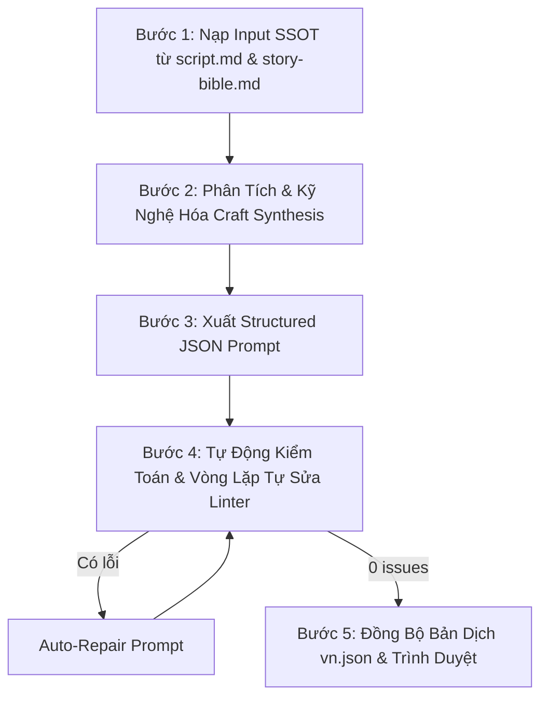

# 🎬 fk-script-to-prompts — Script-to-Prompt Converter & Validator

> **BẮT BUỘC CHO MỌI AGENT (Antigravity `agy` & Claude `claude`):**  
> Khi chuyển thể từ kịch bản phân cảnh (`script.md`) sang file Video Prompt JSON (`prompts_actX.json` / `prompts.json`), **TUYỆT ĐỐI CẤM VIẾT PROMPT AD-HOC TỰ DO LỘN XỘN HOẶC TỰ Ý CHẾ THOẠI**.  
> Agent **BẮT BUỘC** phải vận hành skill này để tích hợp toàn bộ **bộ Screenwriting Skills (`sw-*`)**, **bộ 7 Cinematic Subagents (`fk-*`)**, chạy quy trình **Self-Review & Linter Auto-Repair (`tools/lint_prompt.py`)**, và chỉ xuất file cuối cùng sạch 100% lỗi cho người dùng duyệt.

---

## 1. Danh Mục Các Skill Bắt Buộc Tích Hợp (Skill Registry)

Skill này là điểm hội tụ (Convergence Node) của 3 hệ thống kỹ nghệ:

### A. Hệ Thống Screenwriting Skills (`sw-*`)
1. **`sw-workflow` (Điều phối kịch bản & SSOT)**: Lấy `script.md` và `story-bible.md` làm chân lý tối thượng (Single Source of Truth), đảm bảo tính liên tục của nhịp điệu phân cảnh.
2. **`sw-scene-craft` (Kỹ nghệ phân cảnh - Robert McKee & Lục Quân)**:
   - **5 bước thiết kế cảnh**: Xác định xung đột $\to$ Ghi nhận giá trị mở đầu (+/-) $\to$ Phân rã nhịp (Beats: Hành động/Phản ứng) $\to$ Giá trị kết thúc (+/-) $\to$ Điểm đảo nghịch (Turning Point).
   - **"Chi tiết phải diệu" (细节要妙)**: Chi tiết cụ thể, xúc giác thực tế, loại bỏ hoàn toàn các khái niệm trừu tượng.
   - **"Đạo cụ phải tinh" (道具要精)**: Chuỗi đạo cụ xuyên suốt (mai rùa rỗng gieo nút đứt $\to$ vỡ ở hố nước; rãnh răng T. rex so với bàn tay gieo mầm mà không gọi tên dã thú).
   - **"Ý thú phải đủ" (意趣要足)**: Cài cắm huyền niệm và thủ pháp hoãn binh (Suspense & Delay), nín thở trước hiểm nguy.
3. **`sw-dialogue` (Kỹ nghệ đối thoại - Robert McKee & Lục Quân)**:
   - **Thoại là hành động (Dialogue as action)**: Mỗi câu thoại là một đòn tâm lý / chiến thuật thực hiện mục tiêu.
   - **3 tầng nội dung**: Nói ra (Said), Chưa nói (Unsaid / Subtext), Không thể nói (Unsayable / Sốc sinh tồn).
   - **CẤM TRIỆT ĐỂ On-The-Nose Exposition**: Tuyệt đối không để nhân vật tự giải thích thời gian, địa điểm, bối cảnh như hướng dẫn viên bảo tàng (*"Tôi vừa đến Hell Creek 66 triệu năm TCN..."* $\to$ **CẤM**).
   - **Khóa 100% thoại gốc từ `script.md` §9**: Chuẩn từng từ theo **Rule 49 bảng (0)**, khớp ngắt nhịp `/` theo mốc thời gian (`0-3s / 3-6s / 6-8s` hoặc `0-3s / 3-7s / 7-10s`).
   - **Giọng**: phim — mỗi nhân vật có thoại một voice id riêng (`speech.voices`, `fk-film/references/voice-bible.md` §0). *(Chỉ áp cho POV vlog: giọng Laomedeia — upbeat, conversational, dry humor, thét vỡ giọng khi nguy cấp.)*
4. **`sw-character-conflict` (Xung đột nhân vật & Tâm lý)**:
   - **Khát vọng (Want) vs Nhu cầu (Need)**: Khát vọng ngạo mạn muốn đứng ngoài quan sát vs Nhận thức thực tế mình là một con mồi trong chuỗi thức ăn.
   - **Niềm tin sai lầm (Misbelief)**: Thể hiện rõ niềm tin sai ở Act 1 để chuẩn bị bẻ gãy ở Act 4.
   - **Triệu chứng cơ thể sinh tồn (Body symptoms)**: Tim đập thình thịch, thở dốc qua mũi, run rẩy adrenaline, tay siết chặt.
5. **`sw-story-structure`**: Khung nhịp điệu 起承转合 (Khởi-Thừa-Chuyển-Hợp), Plot Point, Midpoint đảo nghịch.
6. **`sw-format-adaptation`**: Chuẩn hóa chuyển thể nghe-nhìn từ chữ viết sang hình ảnh và âm thanh.
7. **`sw-genre-anatomy`**: Khóa quy chuẩn thể loại của dự án (phim sinh tồn, drama, thảm họa…; POV vlog lịch sử chỉ khi user yêu cầu vlog).

### B. Hệ Thống 7 Cinematic Subagents FlowKit (`fk-*`)
8. **`fk-camera-guide` (Đạo diễn hình ảnh)**:
   - **Phim (`/fk-film`)**: máy điện ảnh ngôi thứ ba (`third-person cinematic camera; the camera itself is never seen`), cỡ cảnh và chuyển động máy theo nhịp kịch, không 2 clip liền nhau cùng cỡ cảnh + góc máy. Các gạch đầu dòng dưới đây **chỉ áp cho POV vlog** (`skills/fk-film/references/vlog-archive.md`).
   - **Chu kỳ góc máy (§7)**: POV (EWS/WS) $\to$ Macro (ECU) $\to$ Hiding/OTS $\to$ Selfie (MCU) $\to$ Fixed (MS).
   - **Ràng buộc cứng**: Cấm 100% selfie, cấm 3 selfie liên tiếp, cấm 2 clip liền nhau cùng góc máy & cỡ cảnh.
   - **Quang học tự nhiên**: 0.5x ultra-wide, vertical footstep bounce, rotational lag, cấm góc nhìn gimbal bay lơ lửng.
   - **Khóa điểm mù quang học (Rule 52)**: Thấu kính máy quay và tay cầm máy luôn nằm ngoài khung hình (`completely outside the visible frame and never seen`). Bàn tay tự do luôn trống (`empty hand`).
   - **CẤM TỪ CẤM (Rule 52)**: Tuyệt đối không chứa `phone`, `smartphone`, `screen`, `device`, `selfie stick`.
9. **`fk-action-choreography` (Vũ đạo hành động & Cơ học vật lý)**:
   - **3 pha động học an toàn**: Chuẩn bị/Hạ trọng tâm $\to$ Một đòn/vector hành động duy nhất $\to$ Thu thế & neo đất.
   - **Chuỗi 4s (Rule 44/49)**: Hành động phức tạp tách thành chuỗi clip 4s, mỗi clip đúng 1 hành động/mắt xích, giữ nguyên góc máy, ánh sáng và bối cảnh, mắt xích sau mở bằng tư thế kết thúc của mắt xích trước.
   - **Rule 51**: Tuyệt đối không cận chiến giáp lá cà người vs dã thú lớn.
10. **`fk-sound-design` (Thiết kế âm thanh 3 lớp)**:
    - Lớp 1: Thoại native khớp khẩu hình (voice id của từng nhân vật; Laomedeia chỉ cho POV vlog).
    - Lớp 2: Foley SFX thực tế (nước bắn, sỏi lạo xạo, bùn nhão, tiếng móng guốc cào đất).
    - Lớp 3: Ambient / Sonic Isolation (tiếng rừng ngập lũ, côn trùng, im lặng nín thở khi dã thú áp sát).
11. **`fk-cinematic-transitions` (Mối nối điện ảnh)**:
    - Match-on-action (khớp cử động), Foreground wipe (dương xỉ/vật thể che khung), Swing/Whip-pan, J-cut âm thanh.
12. **`fk-character-bible` (Khóa nhận diện nhân vật)**:
    - Gắn ref `<Tên>` (Mặt) + `<Tên> Body <trạng thái trang phục>` (Body đã mặc hoàn chỉnh trang phục) cho mỗi nhân vật trong khung. Cấm tự tả lại trang phục bằng lời; nhắc chip ref ngay trong câu khóa (Rule 64).
13. **`fk-scriptwriter`**: Bảo toàn Single Source of Truth, bảng vật lý §10, tính liên tục của ánh sáng và bối cảnh.
14. **`fk-review-video`**: Chuẩn hóa prompt để đạt điểm tối đa trên 6 tiêu chí review.
15. **`Rule 57, 61, 62 (Chất liệu sinh học & Triệt tiêu CGI, Khói, Ánh sáng nhân tạo)`**: Khủng long/dã thú dùng `rough non-reflective pachyderm hide`, ánh sáng `flat natural overcast diffuse daylight`; CẤM 100% `breath vapor`, `vapor mist`, `snorting steam`, `smoke plumes`, `sunlight streaming`, `god rays`.
16. **`Rule 60, 64 (Face Lock = chỉ ảnh ref)`**: MỘT câu khóa trỏ vào chip `FACE LOCK: [Name]'s face is exactly the face in {{ref:[Name]}}, kept 1:1 …`. CẤM tả ngũ quan (mặt, cằm, má, mũi, môi, mắt, tóc, makeup) bằng chữ và CẤM câu phủ định liệt kê bộ phận mặt (user 19/10/2026: "không tả ngũ quan").
17. **`Rule 62 (Deep Focus f/8 Chống Xóa Phông Bokeh)`**: Cảnh medium shot cần thấy bối cảnh bắt buộc `deep focus, deep depth of field (f/8 aperture), entire frame sharp`, cấm shallow DoF / bokeh f/1.8.
17b. **`Rule 65 (Start Frame: liên tục cắt Last Frame, chuyển cảnh mới sinh ảnh — mở rộng 16/10/2026)`**: Với TỪNG clip, so với clip đứng ngay trước trong timeline: cùng địa điểm + cùng khoảnh khắc + cùng vị trí/góc máy + cùng cỡ cảnh (không có cú cắt) ➔ `start_frame = {"type": "PREV_LAST_FRAME", "note": "<lý do>"}`, KHÔNG có `image_prompt`. Áp cho mọi clip nối tiếp, không chỉ ID có hậu tố `a/b/c`. Đổi một yếu tố ➔ `GENERATE_IMAGE` kèm `image_prompt`. Xuất kèm bảng phân loại Start Frame cho User duyệt.

### C. Bộ Quy Chuẩn Prompt Structured JSON & Linter Gate
18. **`fk-prompt-lock`**: Cấu trúc JSON phân cấp bắt buộc, triệt tiêu Attention Decay và Token Drift.
19. **`tools/lint_prompt.py`**: Linter tự động kiểm tra quang học, anti-ghost device, body lock, anti-smoke, anti-god rays, anti-bokeh, schema JSON.

---

## 2. Schema Prompt JSON Chuẩn

Mỗi clip trong mảng JSON `prompts_actX.json` bắt buộc tuân thủ cấu trúc phân cấp:

```json
{
  "clip_id": "Mã clip duy nhất khớp script.md (ví dụ: RA-02, EM-01a)",
  "scene_name": "Tên beat / cảnh",
  "duration": 8,
  "aspect_ratio": "16:9",
  "refs": ["Nora", "Nora Body Ranch", "Eli", "Hale Ranch"],
  "camera": {
    "viewpoint": "third-person cinematic camera; the camera itself is never seen",
    "shot_size": "ECU | CU | MCU | MS | WS | EWS",
    "description": "ống kính, máy cố định hay di chuyển (dolly / track / handheld), bố cục"
  },
  "style": "35mm film, cinematic documentary realism, natural film grain, natural color, real locations and real people",
  "setting": "Location: exactly the place in {{ref:Hale Ranch}} … Light: … (khớp clip trước và sau). Những gì đứng yên ở hậu cảnh suốt clip.",
  "characters": [
    {
      "name": "Nora",
      "visual_lock": "FACE LOCK: Nora's face is exactly the face in {{ref:Nora}}, kept 1:1 … BODY and OUTFIT LOCK: her build and clothing are exactly as in {{ref:Nora Body Ranch}}.",
      "state": "trạng thái ở giây 0 (sạch / bẩn / bỏng / ướt…)"
    }
  ],
  "timeline_action": {
    "0-3s": "hành động 1 + người nói bắt đầu nói ngay từ giây 0: Eli says \"…\" (no subtitles)",
    "3-6s": "hành động 2 + câu đáp",
    "6-8s": "thu thế, kết beat"
  },
  "speech": {
    "speaker": ["Eli", "Nora"],
    "voices": {"Eli": "fenrir", "Nora": "kore"},
    "language": "(chỉ khi thoại không phải English) vd. es-419 Latin American Spanish, neutral Mexican accent — xem fk-film/references/dialogue-es-latam.md",
    "delivery": "native lines in the character's own voice, lip-synced; cảnh cãi nhau: loud, sharp and clipped (Bài học 101)",
    "dialogue": [
      {"t": "0-4s", "speaker": "Eli", "line": "câu thoại nguyên văn từ script.md"},
      {"t": "4-8s", "speaker": "Nora", "line": "câu thoại nguyên văn từ script.md"}
    ]
  },
  "post_vo": ["lời qua bộ đàm / điện thoại / lời dẫn — thêm khi dựng (Bài học 99)"],
  "dramatic_craft": {
    "beat": "nhịp kịch tính: mục tiêu hành động & phản ứng đối kháng",
    "value_turn": "chuyển biến giá trị (+/-)",
    "subtext": "tầng nghĩa ngầm / ý đồ tâm lý của nhân vật",
    "prop_and_detail": "chức năng đạo cụ kịch tính & chi tiết đắt giá (Lu Jun)"
  },
  "audio": "thoại + foley + ambient; giọng nói nổi trên nền",
  "physics": "vận tốc, trọng lực, tiếp xúc, phản lực đất, quán tính",
  "negative_constraints": [
    "No subtitles, no captions, no on-frame text, no logos, no watermarks.",
    "ANTI-CGI LOCK: real documentary footage, not a 3D render, not a video game, not CGI fire, no plastic skin.",
    "No breath vapor and no white steam from anyone's mouth; no god rays, no volumetric beams.",
    "Separate bodies never merge; natural hands with five fingers; no extra limbs.",
    "Spoken words in this clip: N (Rule 49 band for 8s: 18-22)."
  ],
  "props_lock": "(khi có đạo cụ dễ lỗi: một câu tả chuẩn + câu cấm đứt / nhân đôi — Bài học 94, 96)"
}
```

Mẫu thật: `output/embers/prompts_v7_act*.json`. Schema cũ của POV vlog (khóa điểm mù tay cầm máy, cấm `phone`, `BODY LOCK`, giọng Laomedeia) lưu nguyên văn ở `skills/fk-film/references/vlog-archive.md` §4 — chỉ dùng khi user yêu cầu rõ một POV vlog.

---

## 3. Quy Trình Thực Hiện 5 Bước (5-Step Execution Workflow)

Mỗi lần chạy chuyển thể từ kịch bản sang prompt JSON, Agent bắt buộc thực hiện tuần tự:



### Bước 1: Nạp Input SSOT
- Đọc [script.md](file:///c:/flowkit/output/<project>/script.md):
  * §9 Storyboard: Cột Shot, Cột Visual, Cột Thoại (kèm phân nhịp `/`), Cột Từ, Cột Việc, Cột Retention Beat.
  * §10 Bảng vật lý: Máy ở đâu, Frame 0 có gì, Chuyển động (hướng/tốc độ), Rời khung.
  * §3 Material & 7 Mốc ánh sáng (L1 $\to$ L7).
  * §2 Bảng nhân vật & Thực thể tham chiếu.
  * §7 Chu kỳ góc máy.
- Đọc [story-bible.md](file:///c:/flowkit/output/<project>/story-bible.md) để nắm chủ đề, arc nhân vật và nhịp kịch bản.

### Bước 2: Phân Tích & Kỹ Nghệ Hóa (Craft Synthesis)
- **`sw-dialogue`**: Giữ nguyên 100% lời thoại gốc từ `script.md` §9. Không thêm bớt một từ. Đếm đúng số từ chuẩn Rule 49.
- **`sw-scene-craft`**: Viết khối `dramatic_craft` thể hiện rõ mục tiêu, value turn (+/-), subtext, chức năng đạo cụ (mai rùa, rãnh răng, vết bùn).
- **`fk-action-choreography`**: Chuyển đổi mô tả hành động thành 3 pha động học an toàn. Kiểm tra chuỗi 4s đúng luật 1 hành động/mắt xích.
- **`fk-camera-guide`**: Phim — khóa `camera.viewpoint` ngôi thứ ba, không gọi tên vật không muốn thấy. POV vlog — khóa điểm mù quang học, cấm từ chỉ thiết bị.
- **Khóa cao trào tranh cãi (Argument Climax Lock — Bài học 101, user lock 19/10/2026)**: mọi beat cãi nhau, chặn đường, đối đầu, hay ra lệnh dưới áp lực (value turn căng, `dramatic_craft.beat` có xung đột trực diện) BẮT BUỘC ghi giọng **to, gắt, cộc**:
  * `speech.delivery`: `"lip-synced, loud, sharp and clipped like a fire captain giving orders over the roar"` (đổi vai/bối cảnh cho đúng).
  * Nhịp timeline có câu thoại: `"begins speaking immediately, loud and sharp, his/her voice raised over the roar … every word hard, clipped and forceful, each short sentence punched out like an order."`
  * Nhịp giữa và nhịp cuối giữ lực: `"stays loud and hard, jaw clenched, leaning toward …"`, `"finishes on a hard, raised voice and holds the look"`. Người nghe đáp trả bằng thân thể (khựng, nghiến răng, không lùi).
  * `audio`: giọng nói nổi rõ trên nền lửa/gió (`"<name>'s loud, sharp voice clearly on top; … underneath"`).
  * CẤM trong các beat này: `low`, `quiet`, `softly`, `voice drops`, `flat`, `calm`, `natural pace`. Ngoại lệ duy nhất: kịch bản ghi rõ giọng thì thầm đe dọa.
  * Không trích lại câu thoại trong ngoặc kép ở nhịp khác, vì model sẽ nói hai lần.

### Bước 3: Xuất File JSON Prompt
- Ghi ra file `output/<project>/prompts_actX.json` với định dạng JSON hợp lệ.

### Bước 4: Tự Động Kiểm Toán & Vòng Lặp Tự Sửa (Self-Review & Auto-Repair)
Agent tự động chạy command:
```bash
python tools/lint_prompt.py --file output/<project>/prompts_actX.json
```
**Checklist bắt buộc kiểm toán**:
1. Linter trả về `✅ PROMPT LINT PASSED! No ghost devices or viewpoint issues found.`
2. Tuyệt đối không chứa các từ cấm `phone`, `smartphone`, `screen`, `device`, `selfie stick`.
3. *(Chỉ POV vlog)* Điểm mù quang học được khóa bằng câu chuẩn: `"The camera lens itself and her right gripping hand are completely outside the visible frame and never seen."`
4. Số từ thoại trong `speech.dialogue` khớp chính xác 100% số từ đã định trong `script.md` §9.
5. Cảnh hành động phức tạp / chuỗi 4s có đúng 1 hành động và khớp tư thế đầu-cuối.
6. **Anti-Smoke Lock (Rule 62)**: CẤM 100% `breath vapor`, `vapor mist`, `snorting steam`, `smoke plumes`. BẮT BUỘC có `strictly NO smoke, strictly NO breath vapor, strictly NO steam; clean dry nostrils breathing transparent clean air`.
7. **Pachyderm Living Biology & Anti-CGI Lock (Rule 57, 62)**: Khủng long/dã thú dùng `rough non-reflective pachyderm hide`, ánh sáng `flat natural overcast diffuse daylight`; CẤM `sunlight streaming`, `god rays`, `3d render`, `cgi`, `plastic model`.
8. **Deep Focus f/8 Lock (Rule 62)**: BẮT BUỘC `deep focus, deep depth of field (f/8 aperture), entire frame sharp, strictly NO shallow depth of field, strictly NO bokeh`.
9. **Face Lock = chỉ ảnh ref (Rule 60, 64)** — một câu khóa chip `{{ref:<Tên>}}`; không có chữ nào tả ngũ quan, không có câu phủ định liệt kê bộ phận mặt.
10. **Argument Climax Lock (Bài học 101)**: mọi clip có xung đột trực diện dùng giọng to, gắt, cộc (`loud and sharp … clipped and forceful`) ở cả `speech.delivery` lẫn timeline. Các beat này không còn `low`, `quiet`, `voice drops`, `flat`, `natural pace`, và câu thoại không bị trích lại ở nhịp khác.
11. **Nếu có bất kỳ lỗi nào**: Agent PHẢI TỰ ĐỘNG SỬA NGAY LẬP TỨC và chạy lại linter. Vòng lặp tự sửa tối đa 3 lần cho đến khi đạt `0 issues`.

### Bước 5: Đồng Bộ Bản Dịch & Trình Duyệt
- Tự động tạo/cập nhật file `output/<project>/vn.json` dịch chuẩn xác 100% ngữ nghĩa kịch bản, giữ trọn vẹn subtext, punchline và thuật ngữ điện ảnh.
- Xuất báo cáo tóm tắt cho User duyệt trước khi chuyển sang bước tiếp theo của pipeline.

---

## 4. Định Nghĩa Hoàn Thành (Definition of Done)

- [ ] Toàn bộ các cảnh của Act được chuyển thể đầy đủ vào `prompts_actX.json`.
- [ ] 100% lời thoại giữ nguyên bản từ `script.md` §9, chuẩn số từ Rule 49, không tự chế thoại.
- [ ] Khối `dramatic_craft` hiện diện đầy đủ trong từng clip JSON.
- [ ] Mọi cảnh tranh cãi / đối đầu khóa giọng to, gắt, cộc để tạo cao trào (Argument Climax Lock, Bài học 101).
- [ ] Tuân thủ 100% Rule 62: Zero smoke/steam, da thú pachyderm không bóng nhựa, deep focus f/8, và 1:1 face lock.
- [ ] Chạy `python tools/lint_prompt.py` đạt `0 issues`.
- [ ] File `vn.json` được cập nhật đồng bộ, văn phong giàu tính điện ảnh và subtext.
- [ ] Xuất báo cáo và file hoàn chỉnh cho User review.
